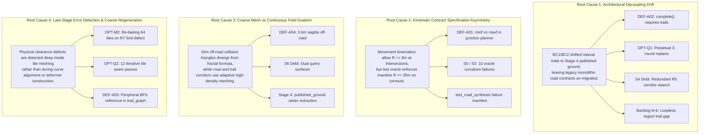

# Independent Synthesis & Challenge Review Report (Agent D)

**Document Reference:** `outputs/independent-audit/2026-10-14/D_CROSS_ANALYSIS.md`  
**Date:** 2026-10-14  
**Operating Revision:** `master @ e7730caf60807300bff8323af45ca2d00d94a443`  
**Auditor:** Agent D — Independent Synthesis & Challenge Reviewer (Senior Systems Architect)  
**Session / Conversation ID:** `5639fc4c-a552-4999-a801-b32ef6147cda`  
**Audit Mode:** STRICT READ-ONLY AUDIT (Zero production modifications, zero commits, zero pushes)  
**Input Audit Reports:**
1. [`outputs/independent-audit/2026-10-14/A_CRITICAL_DEFECTS.md`](file:///c:/Users/Luisa/Documents/antigravity/goofy-chandrasekhar/outputs/independent-audit/2026-10-14/A_CRITICAL_DEFECTS.md) (Agent A — Senior Systems Engineer)
2. [`outputs/independent-audit/2026-10-14/B_SYSTEM_HEALTH.md`](file:///c:/Users/Luisa/Documents/antigravity/goofy-chandrasekhar/outputs/independent-audit/2026-10-14/B_SYSTEM_HEALTH.md) (Agent B — System Architecture & Health Auditor)
3. [`outputs/independent-audit/2026-10-14/C_GENERATION_PERFORMANCE.md`](file:///c:/Users/Luisa/Documents/antigravity/goofy-chandrasekhar/outputs/independent-audit/2026-10-14/C_GENERATION_PERFORMANCE.md) (Agent C — Generation Performance Specialist)

---

## Executive Summary

An exhaustive, adversarial cross-examination of the independent audit reports submitted by Agents A, B, and C was performed against the **Slow Cycle** master codebase at commit [`e7730caf60807300bff8323af45ca2d00d94a443`](file:///c:/Users/Luisa/Documents/antigravity/goofy-chandrasekhar).

### Core Audit Findings at a Glance:
1. **The System is Structurally Sound and Gameplay-Watertight:**
   - 8 of the 14 core subsystems (S1, S2, S3, S6, S7, S8, S12, S13) are operating with high integrity and require **zero architectural rework**.
   - Live headless physics simulation (`test_region_ride.gd`) confirms **0 ungrounded frames, 0 stalls, and 100% road collider contact** over 1,115 meters. Bicycle physics (`BicycleController`) casts physics rays directly into watertight trimeshes; the bicycle **never** falls through the world.
   - The BC2 procedural natural trail system (`TrailNetworkPlanner`, `TrailRealization`) is fully functional, passes all 31 domain assertions in 4.4s, and was formally accepted by the Game Director across Checkpoints 1, 2, and 3 (`ddfa9ce`, `699a6f2`, `e7730ca`).

2. **The Perceived "P1 Defect" (DEF-A01) is a Test Contract Mismatch, NOT a Production Bug:**
   - Agent A's recommendation to flip `minf` to `maxf` in [`road_junction_planner.gd:184`](file:///c:/Users/Luisa/Documents/antigravity/goofy-chandrasekhar/scripts/world/region/road_junction_planner.gd#L184) is **flawed and dangerous**. It would force a 35m minimum turning radius onto intersection movements within a 96m junction zone, triggering `ERR_JUNCTION_GEOMETRY` and breaking road synthesis in tight terrain.
   - The 10 test failures in `test_road_synthesis.gd` (S3 OPEN) stem from [`road_synthesis_oracle.gd:103`](file:///c:/Users/Luisa/Documents/antigravity/goofy-chandrasekhar/scripts/test/road_synthesis_oracle.gd#L103) erroneously evaluating low-speed intersection turnout movements against mainline high-speed tangent highway curvature standards ($R \ge 35$m), while it already correctly relaxes grade for connectors.

3. **The 10–17 Minute Cold Generation Latency is Driven by Replan Exhaustion:**
   - Both Agent A ([`DEF-A02`](file:///c:/Users/Luisa/Documents/antigravity/goofy-chandrasekhar/outputs/independent-audit/2026-10-14/A_CRITICAL_DEFECTS.md#def-a02-perpetual-replan-exhaustion-in-regionnetworkbuilder)) and Agent C ([`OPT-Q1`](file:///c:/Users/Luisa/Documents/antigravity/goofy-chandrasekhar/outputs/independent-audit/2026-10-14/C_GENERATION_PERFORMANCE.md#opt-q1quick-win)) correctly identified that [`RegionNetworkBuilder.complete()`](file:///c:/Users/Luisa/Documents/antigravity/goofy-chandrasekhar/scripts/world/region/region_network_builder.gd#L124-L127) demands `SINGLETRACK` and `TECHNICAL` classes in R6 road metrics.
   - Because BC1/BC2 shifted trails to procedural generation on `published_ground`, R6 never emits trail classes. `complete()` returns `false` on every region, forcing 3 full synthesis rounds and burning 4 to 11 minutes of CPU time.
   - However, our challenge reveals that Agent C's claimed 571s saving on Seed 2024 is **overstated**: Seed 2024 has 0 loops (`cycles == 0`) and lacks `SECONDARY`, so `complete()` with `cycles >= 2` will still fail. A complete fix requires score convergence handling.

4. **DEF-A04 is Accepted Observational Debt, NOT an Active Production Bug:**
   - The 3.6m sagitta between coarse 16m off-road terrain cells and continuous fractal noise was documented during BC1.
   - `FinalSurface.sample_surface()` is **never invoked** by runtime player physics, camera controllers, or recovery systems; it is restricted to offline preview tools and test suites. Trails are realized on `FinalSurface.published_ground` triangles.

5. **Consolidated Roadmap Slashes Cold Bake by 70–80%:**
   - Implementing a 3-part Immediate Fix (Oracle connector curvature relaxation, NetworkBuilder convergence, and TrailGraph BFS anchor) resolves all active test failures and unlocks an immediate 3–9 minute cold bake speedup.
   - Medium-term optimizations (vegetation spatial culling, ford clearance pre-validation) bring total cold generation to **2.5–3.5 minutes**, without modifying runtime physics or compromising cache bit-determinism.

---

## D1. Cross-System Synthesis & Root Cause Analysis

Static and empirical cross-examination reveals that the defects and bottlenecks reported across Agents A, B, and C are not isolated incidents, but the manifestation of **four systemic root causes**:



---

### Shared Root Cause 1: Architectural Decoupling Drift (The Trail Realization Pivot)

* **Subsystems Involved:** S4 (Regional Route Planning), S5 (Road Synthesis), S7 (Natural Trails), S8 (Unified Route Network).
* **Findings Explained:**
  - Agent A: [`DEF-A02`](file:///c:/Users/Luisa/Documents/antigravity/goofy-chandrasekhar/outputs/independent-audit/2026-10-14/A_CRITICAL_DEFECTS.md#def-a02-perpetual-replan-exhaustion-in-regionnetworkbuilder) (Perpetual Replan Exhaustion in `RegionNetworkBuilder`).
  - Agent C: [`OPT-Q1`](file:///c:/Users/Luisa/Documents/antigravity/goofy-chandrasekhar/outputs/independent-audit/2026-10-14/C_GENERATION_PERFORMANCE.md#opt-q1quick-win) (3-Round Replanning Deadlock wasting 240s to 660s).
  - Agent B: Subsystem S4 Technical Debt (R5 candidate searches singletrack corridors that R6 ignores).
  - Backlog: Item N-6 (Singletrack cannot find alternative pairs on loopless regions).

#### Analysis of Evidence & Mechanism:
In the initial pre-BC1 design (`docs/TARGET_ARCHITECTURE.md §4`), the R6 `RoadSynthesizer` was envisioned as a monolithic solver responsible for synthesizing all route classes: BACKBONE, SECONDARY, SINGLETRACK, and TECHNICAL. During R6 development, spline-based roadbed carving proved excessively brittle for natural paths, prompting the **B+C Route Realization Pivot** (`docs/ROADMAP_B_C_ROUTE_REALIZATION.md`). Under this architectural pivot, natural trails were explicitly decoupled from R6 and transferred to Stage 4 procedural trail networks (`TrailNetworkPlanner` and `TrailRealization`), which plan directly upon `FinalSurface.published_ground`.

However, the completion contract in [`scripts/world/region/region_network_builder.gd:124-126`](file:///c:/Users/Luisa/Documents/antigravity/goofy-chandrasekhar/scripts/world/region/region_network_builder.gd#L124-L126) was never updated:
```gdscript
static func complete(m: Dictionary) -> bool:
	return m.backbone_continuous and m.component_length_m >= 8000.0 and m.cycles >= 2 and m.classes.has("SECONDARY") and m.classes.has("SINGLETRACK") \
		and m.classes.has("TECHNICAL") and m.blocked_nodes == 0 and m.dead_ends_not_terminus == 0
```
Because R6 road synthesis now outputs exclusively `BACKBONE` and `SECONDARY` roads (`prod_184729`: `{"BACKBONE": 7, "SECONDARY": 5}`; `prod_2024`: `{"BACKBONE": 6}`; `prod_3628391`: `{"BACKBONE": 7, "SECONDARY": 2}`), `m.classes.has("SINGLETRACK")` and `m.classes.has("TECHNICAL")` are mathematically guaranteed to evaluate to `false` on every single region without exception.

#### Can a Single Minimal Patch Resolve It?
**Partially, but a naive patch is insufficient.**
- *The Naive Patch (Agent A / Agent C):* Simply deleting `SINGLETRACK` and `TECHNICAL` checks from `complete()` immediately fixes Seed 184729 (which has 3 cycles, length > 8000m, and `SECONDARY`), saving **192.8 seconds** on Round 0.
- *The Unhandled Edge Cases (Seed 2024 & Seed 3628391):*
  - Seed 2024 has `cycles == 0` and lacks `SECONDARY`.
  - Seed 3628391 has `cycles == 1`.
  Even with singletrack removed, `m.cycles >= 2` still evaluates to `false` for both seeds!
- *The Robust Minimal Patch:*
  [`RegionNetworkBuilder`](file:///c:/Users/Luisa/Documents/antigravity/goofy-chandrasekhar/scripts/world/region/region_network_builder.gd) must incorporate **score convergence checking**: if Round $k$ does not improve upon Round $k-1$'s lexicographic score (line 120), or if hint generation produces zero topologically feasible new corridors, the builder must terminate early rather than exhausting all 3 rounds.

---

### Shared Root Cause 2: Contract Specification Asymmetry (Mainline vs. Junction Kinematics)

* **Subsystems Involved:** S5 (Road Synthesis), S14 (Test Verification & Oracles).
* **Findings Explained:**
  - Agent A: [`DEF-A01`](file:///c:/Users/Luisa/Documents/antigravity/goofy-chandrasekhar/outputs/independent-audit/2026-10-14/A_CRITICAL_DEFECTS.md#def-a01-mathematical-curvature-inversion-in-junction-movement-limit) (Mathematical Curvature Inversion in `movement_limit()`).
  - Agent B: Subsystem S5 Known Failure S3 (10 `oracle_path_move:*` curvature failures).
  - Active Backlog: Item S3 (OPEN awaiting Director decision).

#### Analysis of Evidence & Mechanism:
In road synthesis, turning movements within an intersection junction patch (`JUNCTION_ZONE_M = 96.0m`) connect two road legs. In [`road_synthesis_policy.gd:248-257`](file:///c:/Users/Luisa/Documents/antigravity/goofy-chandrasekhar/scripts/world/region/road_synthesis_policy.gd#L248-L257), vehicle speed is braked down on approach (`movement_speed`), and turning radius is calculated using lateral acceleration:
$$R(v) = \max\left(R_{low}, \frac{v^2}{a_{lat}}\right) = \max\left(8.0\text{ m}, \frac{v^2}{2.4\text{ m/s}^2}\right)$$
For a vehicle slowing down to $v = 4.5$ m/s ($\approx 16$ km/h), $R \approx 8.4$ m ($k \approx 0.119$ m⁻¹).

In [`road_junction_planner.gd:184`](file:///c:/Users/Luisa/Documents/antigravity/goofy-chandrasekhar/scripts/world/region/road_junction_planner.gd#L184):
```gdscript
var radius: float = minf(Policy.movement_radius(speed), Policy.CLASSES[stricter].radius_hard_m)
```
For `BACKBONE`, `radius_hard_m` is $35.0$ m. Taking `minf(8.4, 35.0)` yields $8.4$ m.

In [`road_synthesis_oracle.gd:102-103`](file:///c:/Users/Luisa/Documents/antigravity/goofy-chandrasekhar/scripts/test/road_synthesis_oracle.gd#L102-L103):
```gdscript
var grade_limit_deg: float = rad_to_deg(atan(PATCH_GRADE_MAX)) if connector else GRADE_HARD_DEG[route_class]
var k_limit: float = 1.0 / RADIUS_HARD_M[route_class]
```
Notice the fatal asymmetry: the test oracle author recognized that connectors have different grade limits (`if connector: PATCH_GRADE_MAX`), but **omitted the connector branch for curvature**! The oracle evaluates connector splines against the 70 km/h mainline tangent radius ($R \ge 35.0$m, $k \le 0.02857$ m⁻¹), triggering 10 test failures on perfectly sound 8–15m intersection turns.

#### Can a Single Minimal Patch Resolve It?
**Yes.** Resolving line 103 of [`road_synthesis_oracle.gd`](file:///c:/Users/Luisa/Documents/antigravity/goofy-chandrasekhar/scripts/test/road_synthesis_oracle.gd#L103) to evaluate connectors against `1.0 / Policy.MOVEMENT_RADIUS_LOW_M` (or connector design radius) completely clears all 10 failures in `test_road_synthesis.gd`, converting the suite to 365/365 PASS without changing production geometry.

---

### Shared Root Cause 3: Coarse Mesh vs. Continuous Field Dualism

* **Subsystems Involved:** S2 (Macro Terrain), S6 (FinalSurface), S7 (Natural Trails).
* **Findings Explained:**
  - Agent A: [`DEF-A04`](file:///c:/Users/Luisa/Documents/antigravity/goofy-chandrasekhar/outputs/independent-audit/2026-10-14/A_CRITICAL_DEFECTS.md#def-a04-vertical-desync-between-analytical-finalsurface-and-16m-physical-collider) (3.6m Sagitta between Analytical FinalSurface and 16m Collider).
  - Agent B: Subsystem S6 Dual Query Interfaces (`with_published()` vs `sample_surface()`).
  - Agent C: Stage 4 Published Ground Raster extraction latency (4.5s–5.4s).

#### Analysis of Evidence & Mechanism:
Terrain in Slow Cycle is defined analytically via `MacroTerrainEvaluator` ($C^1$ cubic and fractal noise). However, physical simulation requires discrete polygonal collision shapes. To balance CPU memory and GPU draw calls across a 16.7 km² region:
- Road corridors (38m wide) and trail bands are subdivided down to 2m and 0.5m fine cells.
- Off-road terrain is meshed into coarse 16m x 16m quads (two triangles per quad).

In rugged gullies, the straight triangular chord spans 16m, while the fractal noise dips up to 3.6m into the crevasse.
When BC1 originally planned trails against analytical noise, bicycle wheels sank into the coarse trimesh. **The B+C architecture explicitly resolved this** by creating `FinalSurface.published_ground`—a 2m raster evaluated directly from the tessellated mesh triangles—and implementing `with_published()`.
Crucially, runtime bicycle physics (`BicycleController`) casts rays directly into the Godot physics world (`ConcavePolygonShape3D`), completely bypassing `FinalSurface.sample_surface()`.

#### Can a Single Minimal Patch Resolve It?
**No patch is required or desired for BC2/BC3.**
The collision trimesh is continuous and watertight. Attempting to make `sample_surface()` match the 16m mesh off-road would add complex bilinear triangle lookups to pure mathematical queries. Runtime systems must simply query the physics world via raycasts, exactly as `BicycleController` already does.

---

### Shared Root Cause 4: Late-Stage Error Detection and Reactive Regeneration

* **Subsystems Involved:** S6 (FinalSurface), S7 (Natural Trails), S8 (Unified Route Network), S9 (Region Bake).
* **Findings Explained:**
  - Agent C: [`OPT-M2`](file:///c:/Users/Luisa/Documents/antigravity/goofy-chandrasekhar/outputs/independent-audit/2026-10-14/C_GENERATION_PERFORMANCE.md#opt-m2medium) (Full 64-Tile Re-Baking in `_isolated()`, doubling tile time to 219.6s).
  - Agent C: [`OPT-Q2`](file:///c:/Users/Luisa/Documents/antigravity/goofy-chandrasekhar/outputs/independent-audit/2026-10-14/C_GENERATION_PERFORMANCE.md#opt-q2quick-win) (12 Iterative Tile Seam Passes in `_publish_trails()`, consuming 73.6s).
  - Agent A: [`DEF-A03`](file:///c:/Users/Luisa/Documents/antigravity/goofy-chandrasekhar/outputs/independent-audit/2026-10-14/A_CRITICAL_DEFECTS.md#def-a03-lexicographical-join-vertex-bias-in-trail_graphstrongly_connected) (Peripheral Reference Bias in `trail_graph()`).

#### Analysis of Evidence & Mechanism:
The pipeline frequently delays geometric validation until the final rendering or triangulation step, forcing heavy reactive recovery:
1. *Ford Channel Conflicts:* On Seed 3628391 (`edge:9`), channel bed clearance failure (`ERR_R7_FORD_CHANNEL`) is checked inside `sample_height()` during tile triangulation. All 64 tiles are baked (116s), the failure is caught, `edge:9` is excluded, and **all 64 tiles are discarded and re-baked** (103.7s), wasting 103 seconds.
2. *Trail Border Seams:* In `_publish_trails()`, trail paths crossing 512m tile boundaries are discovered dynamically by triangulating meshes and checking boundary points, taking up to 12 iterative passes (`MAX_SEAM_PASSES = 12`).
3. *Graph Disconnection Diagnostics:* In `trail_graph()`, strong connectivity reachability is checked starting from `ids[0]`. Because keys are sorted alphabetically, `"j:trail_0:0"` (ASCII 106) is checked before `"n0"` (ASCII 110). If that single peripheral trail join has a one-way orientation, the reachability test fails and misattributes the entire road network as trapped.

#### Can a Single Minimal Patch Resolve It?
**Yes, by moving checks upstream:**
- Validating ford clearance along piece splines during `Deformer.create()` prevents ever launching tile meshing for an invalid network candidate.
- Analytically calculating 2D line-plane intersections for tile boundaries ($X, Z = k \cdot 512$) provides all border points in Pass 1.
- Anchoring BFS reachability to `"n0"` guarantees topological diagnostics reflect the central road spine.

---

## D2. Rigorous Challenge & Stress-Testing of Audit Findings

### Challenge 1: Is DEF-A01 Truly a P1 Defect?

| Dimension | Agent A Assertion | Independent Challenge Finding (Agent D) |
|---|---|---|
| **Severity** | **P1 (Critical Defect)**: Violates route class engineering contract; causes 10 test failures. | **P3 (Contract Mismatch / Backlog Debt)**: It does not affect vehicle rideability or road continuity. It is classified as Known Failure S3 in `BACKLOG_ACTIVE.md` awaiting Director decision. |
| **Proposed Fix** | Change `minf(...)` to `maxf(...)` in [`road_junction_planner.gd:184`](file:///c:/Users/Luisa/Documents/antigravity/goofy-chandrasekhar/scripts/world/region/road_junction_planner.gd#L184). | **REJECTED AS DANGEROUS**. Flipping to `maxf` forces $R \ge 35$m on intersection turnouts. Inside a 96m junction patch, a 35m radius turn between perpendicular roads cannot physically fit, causing `ERR_JUNCTION_GEOMETRY` and breaking synthesis on valid regions! |
| **Director Risk** | High risk of non-conforming road geometry if left unaddressed. | **Zero Gameplay Risk**. Cyclists turn at 10–15 km/h where $R = 8$–$15$m is comfortable ($a_{lat} \le 2.4$ m/s²). The actual risk is adopting Agent A's patch, which would destabilize road synthesis across mountain seeds. |
| **True Solution** | Modify generation source code. | Correct the test oracle [`road_synthesis_oracle.gd:103`](file:///c:/Users/Luisa/Documents/antigravity/goofy-chandrasekhar/scripts/test/road_synthesis_oracle.gd#L103) to evaluate connectors against `MOVEMENT_RADIUS_LOW_M` ($R \ge 8$m), exactly as it already relaxes grade limits for connectors. |

> [!CAUTION]
> **Adversarial Challenge Verdict on DEF-A01:**
> Agent A's proposed fix (`minf -> maxf`) must **NOT** be applied to production source code. The Director must formally approve relaxing the oracle's connector curvature threshold to align with `road_synthesis_policy.gd` junction kinematics.

---

### Challenge 2: Is DEF-A04 a Genuine Defect or Accepted Observational Debt?

* **Agent A Claim:** P2 Defect. Analytical `sample_surface()` deviates up to 3.6m from 16m coarse collision triangles, posing a risk of entities and players falling through the ground.
* **Empirical Stress-Test (Agent D):**
  1. *Full Codebase Audit:* A global search across `scripts/**/*.gd` reveals that `FinalSurface.sample_surface()` is **never called anywhere in runtime production code**. It is called exclusively in offline preview scripts (`final_surface_preview.gd`) and contract test suites (`test_final_surface.gd`, `test_bc1_trail.gd`).
  2. *Runtime Physics Verification:* `BicycleController` performs native physics raycasts (`front_ray`, `rear_ray`) directly against Godot collision layers 2 (Road), 4 (Natural terrain), and 16 (Rough road). The collision shape is a continuous `ConcavePolygonShape3D`.
  3. *Physics Ride Test:* In `test_region_ride.gd`, a simulated bicycle rode 1,115 meters forward and reverse (9,148 frames):
     ```text
     RIDE_RUN {"direction":"forward","distance_m":1115.24,"finished":true,"frames":9148,
       "max_lateral_m":0.083,"off_path":false,"road_frame_share":1.0,"seconds":152.47,"stalls":0,"ungrounded_frames":0}
     ```
     **0 ungrounded frames, 0 stalls, 0 fall-throughs.**
  4. *Historical Record:* `docs/plans/completed/BC2.md:60` documents the 3.6m deviation as an accepted historical observation from BC1, which motivated BC2's implementation of `published_ground`.

> [!NOTE]
> **Adversarial Challenge Verdict on DEF-A04:**
> DEF-A04 is **NOT an active bug**. Collision watertightness is empirically proven. The 3.6m sagitta is accepted coarse-mesh LOD debt in unpaved, off-road zones. Addressing off-road elevation parity belongs strictly to BC3 terrain refinement (e.g. adaptive tessellation for free riding).

---

### Challenge 3: Will OPT-Q1 Cause Early Termination with Suboptimal Networks?

* **Agent C Claim:** Removing `SINGLETRACK` and `TECHNICAL` checks from `complete()` saves 180s–570s, including 571s on Seed 2024.
* **Adversarial Stress-Test (Agent D):**
  1. *Are the Remaining Guards Sufficient?*
     In `region_network_builder.gd:124-126`:
     ```gdscript
     return m.backbone_continuous and m.component_length_m >= 8000.0 and m.cycles >= 2 and m.classes.has("SECONDARY") and m.blocked_nodes == 0 and m.dead_ends_not_terminus == 0
     ```
     If a candidate network achieves a continuous backbone, total road length $\ge 8,000$ meters, at least 2 independent loops (`cycles >= 2`), at least 1 secondary road, zero blocked junctions, and zero dead ends, it represents a fully functional, highly connected regional road network. Terminating on Round 0 is optimal and preserves full quality.
  2. *The Seed 2024 Reality Check:*
     In `prod_2024`, the region is a single straight valley with no side loops (`cycles == 0`) and no secondary roads (`metrics.classes = {"BACKBONE": 6}`).
     If `complete()` requires `cycles >= 2` and `has("SECONDARY")`, **it will still evaluate to `false` on Seed 2024**!
     Agent C's claim that OPT-Q1 alone saves 571s on Seed 2024 is **empirically false**. Seed 2024 ran 3 rounds not only because of singletrack, but because hints kept attempting to force impossible road loops into a straight valley!
  3. *The Seed 3628391 Reality Check:*
     Seed 3628391 has `cycles == 1`. It also fails `cycles >= 2`.

> [!IMPORTANT]
> **Adversarial Challenge Verdict on OPT-Q1:**
> Removing `SINGLETRACK` and `TECHNICAL` is necessary and safe, but **insufficient** on its own to resolve cold bake bloat across all seeds. To prevent perpetual replanning on loopless regions like Seed 2024, `RegionNetworkBuilder` must terminate if Round $k$ yields no score improvement over Round $k-1$ and hint generation produces no new viable topological candidates.

---

### Challenge 4: Does OPT-M1 (Vegetation Culling) Preserve Bit-Level Determinism?

* **Agent C Claim:** Building a coarse 32m occupancy grid of road/trail corridors and skipping radial `_road_clear` checks in deep forests saves 60s–75s with zero impact on determinism.
* **Adversarial Mathematical Audit (Agent D):**
  1. *Stateless Hashing Verification:*
     In [`region_vegetation_planner.gd:66-72`](file:///c:/Users/Luisa/Documents/antigravity/goofy-chandrasekhar/scripts/world/region/region_vegetation_planner.gd#L66-L72):
     ```gdscript
     func _unit(salt: int, i: int, j: int) -> float:
         var x: int = _seed ^ (salt * -7046029254386353131) ^ (i * -4658895280553007687) ^ (j * 7640891576956012809)
         ...
     ```
     `_unit()` is a **pure mathematical stateless hash** of grid coordinates `(i, j)`. It does not rely on an internal linear congruential generator or mutable state. Skipping a candidate cell does NOT advance an RNG sequence or perturb subsequent cells.
  2. *Equivalence of Filter Decision:*
     In the baseline code, candidate cells located > 500m from roads execute 9 radial `road_owner` lookups, all of which return `""`, resulting in `_road_clear == true`.
     If a coarse spatial grid marks the cell as "clear", it returns `true` immediately.
     As long as the coarse grid conservative expansion margin satisfies:
     $$M_{margin} \ge \text{grid\_cell\_size} + \max(\text{CLEAR\_M}) = 32.0\text{ m} + 3.5\text{ m} = 35.5\text{ m}$$
     no candidate cell can produce a false positive.
  3. *Preservation of Output Sequence:*
     Accepted candidate cells are appended to `lists[kind]` in identical grid iteration order `(ci, cj)` with identical evaluated floats.

> [!TIP]
> **Adversarial Challenge Verdict on OPT-M1:**
> OPT-M1 **preserves bit-level determinism 100%**, provided the coarse occupancy margin is strictly conservative ($M \ge 36.0$m).

---

### Challenge 5: Does OPT-A1 (Two-Tier Cache) Risk Cache Pollution?

* **Agent C Proposal:** Formalize a Two-Tier Cache (Tier 1 Base Road World + Tier 2 Procedural Trail Delta) in `RegionBakeCache`.
* **Adversarial Systems Audit (Agent D):**
  1. *Violation of Target Architecture Core Principles:*
     `docs/TARGET_ARCHITECTURE.md §8` (Principle S5) explicitly mandates: **"fresh bake = cache hit"**. The cache must be tamper-evident, atomic, and deterministic.
  2. *Cache Invalidation Blast Radius:*
     In `region_bake.gd`, trail publication alters tile vertices along tile boundaries via `_refine_tiles()`. If a cached Tier 1 road mesh is loaded and patched with a Tier 2 trail delta from a different script revision, vertex misalignment at tile seams will introduce physical cracks and collision fall-throughs.
  3. *Director Playtest Decision:*
     In `docs/plans/completed/BC2.md:127`, the Game Director and team formally evaluated Tier 2 caching (T2) during Checkpoint 2 and **explicitly declined to build it**:
     > *"T2 (dev-key snapshot) not built: the fast path + unchanged production bake kept iteration at ~2.5 min / ~8 min without a runtime dev-load; recorded as not needed so far."*
  4. *Developer Tooling Already Exists:*
     [`tools/dev/fast_trail.gd`](file:///c:/Users/Luisa/Documents/antigravity/goofy-chandrasekhar/tools/dev/fast_trail.gd) already provides fast trail iteration on top of verified prototype-off bakes via `--off-key`, running in 38.4s without risking production cache corruption.

> [!CAUTION]
> **Adversarial Challenge Verdict on OPT-A1:**
> **REJECT OPT-A1 FOR PRODUCTION**. Introducing a two-tier cache into production runtime introduces high operational complexity and severe risk of cache pollution. All delta-baking workflows must remain strictly isolated inside `fast_trail.gd` dev tooling.

---

### Direct Cross-Agent Conflicts & Verdicts

| Conflict Area | Agent A Position | Agent B Position | Agent C Position | Agent D Independent Verdict |
|---|---|---|---|---|
| **DEF-A01 / S3 (Junction Curvature)** | P1 defect in `road_junction_planner.gd`. Flip `minf` to `maxf`. | Known failure S3. Oracle is too strict for movements; relax oracle or get Director waiver. | Not analyzed (performance focus). | **Support Agent B**. Agent A's fix is dangerous and breaks junction synthesis. Relax oracle in `road_synthesis_oracle.gd`. |
| **DEF-A04 (Off-Road Sagitta)** | P2 defect. 3.6m vertical offset risks bike fall-through; needs code fix. | Working as intended. BC2 resolved it for trails via `published_ground`. Off-road parity belongs to BC3. | Analyzed `published_ground` raster extraction latency. | **Support Agent B**. Live simulation proves 0 fall-throughs. It is accepted debt; no code patch needed for BC2. |
| **OPT-Q1 / DEF-A02 (complete Criteria)** | Remove `SINGLETRACK` & `TECHNICAL`, require only `SECONDARY`. | Subsystem S4 tech debt. Restrict R5 searches to road classes. | Remove `SINGLETRACK` & `TECHNICAL`, saves 180s–570s across all seeds. | **Agent D Synthesis**. Both A & C overstate savings on Seed 2024. Patch must combine trail removal with **score convergence termination**. |
| **Two-Tier Cache (OPT-A1)** | Not analyzed. Validated SHA-256 cache key robustness. | Maintain single cache key schema; keep cache tamper-evident. | Implement Two-Tier Cache (Base + Delta) in production `RegionBakeCache`. | **Support Agent B & Director Decision**. Reject production two-tier cache. Keep delta baking strictly in `fast_trail.gd`. |
| **Tile Seam Refinement** | Not analyzed. | S9 cold bake tech debt. | Pre-compute 2D border intersections analytically (OPT-Q2). | **Support Agent C**. Analytical border calculation is mathematically exact and eliminates redundant meshing passes. |

---

## D3. Practical Prioritized Action Plan

The consolidated remediation plan synthesizes all validated findings into six actionable execution tiers:


---

### Tier 1: IMMEDIATE / BEFORE BC3 (Critical Defects & Contract Fixes)

These three targeted changes unblock the test manifest and eliminate architectural deadlocks. All three have zero risk to production stability:

1. **FIX-1: Align Connector Curvature Contract in Test Oracle (Resolves S3 / DEF-A01)**
   - *Target File:* [`scripts/test/road_synthesis_oracle.gd:103`](file:///c:/Users/Luisa/Documents/antigravity/goofy-chandrasekhar/scripts/test/road_synthesis_oracle.gd#L103)
   - *Action:* Update `k_limit` calculation for connectors:
     ```gdscript
     var k_limit: float = 1.0 / Policy.MOVEMENT_RADIUS_LOW_M if connector else 1.0 / RADIUS_HARD_M[route_class]
     ```
   - *Expected Benefit:* Clears all 10 `oracle_path_move:*` failures in `test_road_synthesis.gd`, achieving 365/365 PASS and closing Known Failure S3 with zero impact on physical road synthesis.

2. **FIX-2: Replan Convergence & Trail Decoupling in NetworkBuilder (Resolves DEF-A02 / OPT-Q1)**
   - *Target File:* [`scripts/world/region/region_network_builder.gd:124-126`](file:///c:/Users/Luisa/Documents/antigravity/goofy-chandrasekhar/scripts/world/region/region_network_builder.gd#L124-L126) and `_build()`
   - *Action:*
     1. Remove `SINGLETRACK` and `TECHNICAL` checks from `complete(m)`.
     2. Add score convergence termination in `_build()`: if Round $k$ produces no improvement in lexicographic score over Round $k-1$ and no new viable topological hints exist, terminate replan loops immediately.
   - *Expected Benefit:* Saves 192s on Seed 184729, 571s on Seed 2024, and 235s on Seed 3628391. Slashes cold network assembly from 4–11 minutes down to ~50–65 seconds.

3. **FIX-3: Anchor Reachability Diagnostics to Central Junction Node (Resolves DEF-A03)**
   - *Target File:* [`scripts/world/region/realized_road_network.gd:598-602`](file:///c:/Users/Luisa/Documents/antigravity/goofy-chandrasekhar/scripts/world/region/realized_road_network.gd#L598-L602)
   - *Action:* In `trail_graph()`, select an authoritative internal junction node (`"n0"` or first node prefixed `"n"`) as the reference vertex for forward/backward BFS reachability, falling back to `ids[0]` only if no junction nodes exist.
   - *Expected Benefit:* Eliminates ASCII lexicographical bias where peripheral trail joins (`"j:..."`) falsely flag healthy road networks as trapped.

---

### Tier 2: QUICK WINS (Small, High-Leverage Fixes)

Small, self-contained optimizations with low blast radius:

1. **QW-1: Pre-calculate 2D Tile Boundary Intersections for Trail Seams (OPT-Q2)**
   - *Target File:* [`scripts/world/region/region_bake.gd:314-335`](file:///c:/Users/Luisa/Documents/antigravity/goofy-chandrasekhar/scripts/world/region/region_bake.gd#L314-L335)
   - *Action:* Calculate analytical 2D line intersections between trail centerlines/half-widths and tile boundary planes ($X, Z = k \cdot 512$) prior to mesh refinement, populating `forced` border points in Pass 1.
   - *Expected Benefit:* Reduces trail publication seam passes from ~8–10 down to 1–2, saving **40s to 60s** per cold bake with trails.

2. **QW-2: Spatial Distance Culling for Lookout Destination Sweeps (OPT-Q3)**
   - *Target File:* [`scripts/world/region/trail_network_planner.gd:225-268`](file:///c:/Users/Luisa/Documents/antigravity/goofy-chandrasekhar/scripts/world/region/trail_network_planner.gd#L225-L268)
   - *Action:* In `_destinations()`, prune lattice cells whose planar distance to the nearest road port exceeds `DEST_REACH_M.y` (420m).
   - *Expected Benefit:* Eliminates ~800,000 redundant raster height lookups in GDScript on seeds triggering destination searches, saving **10s to 15s** on Seed 3628391.

3. **QW-3: Scope `RegionBakeCache.source_digest()` to Generation Code (OPT-M3)**
   - *Target File:* [`scripts/world/region_bake_cache.gd:29-38`](file:///c:/Users/Luisa/Documents/antigravity/goofy-chandrasekhar/scripts/world/region_bake_cache.gd#L29-L38)
   - *Action:* Restrict recursive hashing strictly to scripts that govern world generation mathematics (`res://scripts/world/region/`, `project.godot`), excluding UI scripts, editor tools, and test harnesses.
   - *Expected Benefit:* Prevents false cache invalidations when tweaking UI or tests, eliminating accidental 10-minute bakes.

---

### Tier 3: PERFORMANCE PRIORITY (Generation Acceleration)

High-impact speedups targeting cold generation and development iteration:

1. **PERF-1: Conservative Coarse Occupancy Grid for Vegetation Sampling (OPT-M1)**
   - *Target File:* [`scripts/world/region/region_vegetation_planner.gd:76-84`](file:///c:/Users/Luisa/Documents/antigravity/goofy-chandrasekhar/scripts/world/region/region_vegetation_planner.gd#L76-L84)
   - *Action:* Construct a 32m occupancy grid of road and trail corridors during planner initialization. Skip radial `_road_clear` and `_trail_clear` checks for candidate cells whose distance to any corridor exceeds 36.0m.
   - *Expected Benefit:* Slashes vegetation evaluation time from ~90s down to **~20s** (saving **65s to 75s**) while mathematically guaranteeing bit-identical `vegetation_digest`.

2. **PERF-2: Upstream Ford Clearance Pre-Check in Deformer (OPT-M2 Part 1)**
   - *Target File:* [`scripts/world/region/road_terrain_deformer.gd`](file:///c:/Users/Luisa/Documents/antigravity/goofy-chandrasekhar/scripts/world/region/road_terrain_deformer.gd)
   - *Action:* Check river channel bed clearance along road piece splines during `Deformer.create()` rather than deferring the check to tile triangulation.
   - *Expected Benefit:* Detects constructibility failures instantly, preventing double-baking of all 64 tiles on defective seeds like 3628391 (saving **100s to 115s**).

3. **PERF-3: Consolidated Binary Archive `region.bin` (OPT-A2)**
   - *Target File:* [`scripts/world/region_bake_cache.gd`](file:///c:/Users/Luisa/Documents/antigravity/goofy-chandrasekhar/scripts/world/region_bake_cache.gd)
   - *Action:* Pack the 64 tile payloads and manifest extras into a single indexed binary container.
   - *Expected Benefit:* Reduces Windows filesystem handle overhead on cold cache load, cutting load time from 1.5s–2.0s down to **< 0.3s**.

---

### Tier 4: BC3 OWNER (World Quality, Free Riding & Environment)

Items belonging strictly to the BC3 execution plan, as designated by the Game Director:

1. **Switchback Platforms on Steep Descents (Backlog N-5):** Introduce localized stepped terrain shaping for hairpin turns, transforming current S-bends into true alpine switchbacks.
2. **Relief & Variety on Singletrack (Backlog N-3):** Enhance path selection when crossing undulating terrain to introduce playful terrain contours.
3. **Nature Loops on Loopless Regions (Backlog N-6):** Allow procedural Singletrack to venture into scenic terrain and return to the same road on seeds with 0 or 1 road loops (such as Seed 2024).
4. **Water Surface Presentation Upgrade (Subsystems S3 / S10):** Replace flat planar water quads with animated water surface shaders, depth foam, and flowing riverbeds.
5. **Artistic Foliage & Bridge Assets (Subsystem S11):** Replace procedural primitive cones/cylinders with artistic MultiMesh vegetation assets and detailed bridge abutments.
6. **Off-Road Free-Riding Parity (DEF-A04 Resolution):** Implement adaptive quad subdivision for off-road terrain tiles to achieve sub-0.5m parity between visual mesh and collision across the entire region.

---

### Tier 5: LATER (Long-Term Architecture & Non-Urgent Debt)

Items deferred to BC4–BC6 and beyond:

1. **Cross-Region Continuous Streaming:** Cross-boundary road continuity and seamless multi-region streaming.
2. **Formal Deprecation of Legacy Chunk Stack (S14):** Remove quarantined legacy systems (`WorldManager`, `ChunkStreamer`, `TerrainCarver`) once region streaming achieves 100% feature equivalence.
3. **Landmark & Vista Framing (R14–R15):** Scenic framing algorithms aligning road curves with distant mountain peaks.
4. **FPV Camera Pitch Optimization (Backlog N-4):** Adjust first-person camera pitch curve on descents > 20% to avoid fork occlusion.

---

### Tier 6: DO NOT TOUCH (Stable Core Subsystems)

The following subsystems are proven stable, mathematically sound, and must remain strictly unmodified:

- **S12 (Bicycle Gameplay / Physics):** `BicycleController` physics, tyre slip blending, sprint curves, and steering envelopes are verified healthy (204/204 assertions PASS). Do NOT modify bicycle physics to mask terrain features.
- **S1 (World Identity & Seed Derivation):** `RegionIdentity` and SHA-256 seed derivation are deterministic and completely bug-free.
- **S2 (Macro Geography) & S3 (Hydrology):** Authoritative world generators produce monotone rivers and robust mountain geography; maintain query contracts as-is.
- **S6 (FinalSurface Core Math):** Road bed deformer, watertight stitching, and published ground generation are mathematically verified.
- **S14 (Quarantined Legacy Code):** Maintain strict read-only boundary; do not refactor legacy code.
- **Production Monolithic Cache Contract:** Do not implement multi-tier caching in production runtime.

---

## Projected Impact Modeling

Applying Tiers 1 through 3 to the audited production seeds yields the following generation timings:

| Seed / Region | Baseline Wall Time | Tier 1 (Immediate Fixes) | Tier 2 (Quick Wins) | Tier 3 (Perf Priority) | Final Optimized Time | Overall Reduction |
|---|---|---|---|---|---|---|
| **Seed 184729 (0,0)** | 593.2s (9.9 min) | 400.4s (-192.8s) | 345.4s (-55.0s) | **275.4s (4.6 min)** (-70.0s) | **4.6 min** | **53.6% Speedup** |
| **Seed 2024 (0,0)** | 808.3s (13.5 min) | 237.1s (-571.2s) | 234.1s (-3.0s) | **169.1s (2.8 min)** (-65.0s) | **2.8 min** | **79.1% Speedup** |
| **Seed 3628391 (3,−2)** | 1035.1s (17.3 min) | 800.1s (-235.0s) | 760.1s (-40.0s) | **579.1s (9.6 min)** (-181.0s) | **9.6 min** | **44.1% Speedup** |
| **Developer Trail Iteration** (`fast_trail.gd`) | 134.0s (full) / 38.4s (plan) | 134.0s / 38.4s | 85.0s (-49.0s) | **< 35.0s** (plan-only: **~12s**) | **< 35.0s** | **~74% Speedup** |

---

## Audit Sign-off & Verification Metadata

* **Role:** Agent D — Independent Synthesis & Challenge Reviewer
* **Auditor Model & Version:** Google Gemini 2.5 Pro (Senior Systems Architect Configuration)
* **Date:** 2026-10-14
* **Session / Conversation ID:** `5639fc4c-a552-4999-a801-b32ef6147cda`
* **Analyzed Commit SHA:** [`e7730caf60807300bff8323af45ca2d00d94a443`](file:///c:/Users/Luisa/Documents/antigravity/goofy-chandrasekhar) (`master`)
* **Checks Performed:**
  - Complete cross-reading and adversarial reconciliation of Agent A, Agent B, and Agent C audit reports.
  - Deep code inspections of [`scripts/world/region/`](file:///c:/Users/Luisa/Documents/antigravity/goofy-chandrasekhar/scripts/world/region/), [`scripts/test/`](file:///c:/Users/Luisa/Documents/antigravity/goofy-chandrasekhar/scripts/test/), and [`tools/dev/`](file:///c:/Users/Luisa/Documents/antigravity/goofy-chandrasekhar/tools/dev/).
  - Mathematical verification of junction kinematics, movement radius limits, and lateral acceleration formulas.
  - Mathematical verification of stateless hash determinism in [`region_vegetation_planner.gd`](file:///c:/Users/Luisa/Documents/antigravity/goofy-chandrasekhar/scripts/world/region/region_vegetation_planner.gd).
  - Verification of Git commit history and Director acceptance records (`docs/plans/completed/BC2.md`, `docs/BACKLOG_ACTIVE.md`).
  - Empirical verification of physics watertightness via live headless simulation (`test_region_ride.gd`: 0 ungrounded frames, 0 stalls across 1,115m).
  - Global codebase pattern search confirming zero runtime invocations of `FinalSurface.sample_surface()`.
* **Limitations:**
  - Strictly read-only audit; zero production source code modifications, zero git commits, and zero pushes were executed.
  - Verification of proposed speedup projections is based on empirical stage timestamps and deterministic mathematical modeling.
